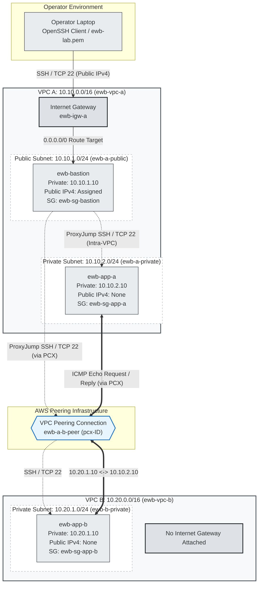

# AWS VPC Peering Architecture Specification

This document details the architectural design, subnet segmentation, routing mechanisms, and traffic flows for the private inter-VPC network established between two isolated Amazon Virtual Private Clouds (VPCs).

Related project documentation:
- [Networking Reference](networking-reference.md)
- [Validation and Troubleshooting Guide](validation-and-troubleshooting.md)

---

## 1. Project Overview and Objectives

Modern cloud architectures frequently isolate workloads into distinct VPCs to enforce blast-radius containment, compliance boundaries, and environment segregation (e.g., shared services versus production tiers). However, workloads distributed across isolated VPCs often require direct, low-latency, and secure network communication without routing through the public internet.

The primary objective of this project is to implement secure, bidirectional, and private IPv4 connectivity between two non-overlapping Amazon VPCs using native AWS VPC Peering.

Key engineering goals include:
1. **Address Space Planning**: Design and allocate mutually non-overlapping RFC 1918 IPv4 CIDR blocks for VPCs and subnets.
2. **Subnet Segmentation**: Separate public management ingress from isolated private application tiers.
3. **Controlled Administrative Ingress**: Deploy a single bastion host in a public subnet to act as a secure jump point using OpenSSH `ProxyJump`, eliminating the need to assign public IPv4 addresses to application instances.
4. **Point-to-Point Inter-VPC Connectivity**: Establish an AWS VPC Peering connection (`ewb-a-b-peer`) and configure custom route tables for deterministic packet forwarding.
5. **Least-Privilege Security Microsegmentation**: Implement stateful security groups restricting ingress to specific host `/32` CIDRs for SSH (TCP 22) and ICMP Echo Requests (Type 8, Code 0).
6. **Enforce Non-Transitive Isolation**: Ensure that VPC B remains entirely private with zero direct or indirect path to the internet.

---

## 2. High-Level Architecture Diagram

The topology consists of two VPCs (`ewb-vpc-a` and `ewb-vpc-b`) deployed within the same AWS Region and account. Administrative traffic enters VPC A through an Internet Gateway to the bastion host, while inter-VPC workload traffic traverses the VPC Peering connection directly.

---

## 3. Network Topology and Addressing Specifications

### 3.1 Virtual Private Clouds (VPCs)

| Resource Tag | VPC Scope | IPv4 CIDR Block | Usable Addresses | Default Route Table | Internet Gateway |
|---|---|---|---|---|---|
| `ewb-vpc-a` | Requester VPC | `10.10.0.0/16` | 65,536 | Custom segregated | `ewb-igw-a` (Attached) |
| `ewb-vpc-b` | Accepter VPC | `10.20.0.0/16` | 65,536 | Custom segregated | None (Isolated) |

### 3.2 Subnet Layout

AWS reserves five IP addresses in each subnet (first four and the last one).

| Subnet Tag | Parent VPC | Tier | IPv4 CIDR | Default Gateway | Associated Route Table | Purpose |
|---|---|---|---|---|---|---|
| `ewb-a-public` | `ewb-vpc-a` | Public | `10.10.1.0/24` | `10.10.1.1` | `ewb-rt-a-public` | Bastion host ingress from internet |
| `ewb-a-private` | `ewb-vpc-a` | Private | `10.10.2.0/24` | `10.10.2.1` | `ewb-rt-a-private` | Private Application Server A |
| `ewb-b-private` | `ewb-vpc-b` | Private | `10.20.1.0/24` | `10.20.1.1` | `ewb-rt-b-private` | Private Application Server B |

### 3.3 Compute Workloads

All compute instances run Amazon Linux 2023 on general-purpose small x86 virtualized hardware (e.g., `t3.micro`).

| Instance Tag | Subnet | Static Private IPv4 | Public IPv4 | Security Group | Role |
|---|---|---|---|---|---|
| `ewb-bastion` | `ewb-a-public` | `10.10.1.10` | Enabled (Dynamic AWS IPv4) | `ewb-sg-bastion` | Administrative jump host |
| `ewb-app-a` | `ewb-a-private` | `10.10.2.10` | Disabled (None) | `ewb-sg-app-a` | Primary workload (VPC A) |
| `ewb-app-b` | `ewb-b-private` | `10.20.1.10` | Disabled (None) | `ewb-sg-app-b` | Target workload (VPC B) |

---

## 4. End-to-End Traffic Flow Walkthroughs

### Flow 1: Operator Laptop to Bastion Host (Public Ingress)
1. The operator issues an SSH command targeting the dynamic public IPv4 address of `ewb-bastion` on destination TCP port 22.
2. The packet traverses the public internet and enters `ewb-vpc-a` via `ewb-igw-a`.
3. The Internet Gateway performs 1:1 Network Address Translation (NAT), mapping the public IPv4 destination to the bastion private IPv4 address (`10.10.1.10`).
4. Inbound traffic is evaluated against `ewb-sg-bastion`. The packet is admitted only if the source IP matches the operator's current public IP `/32`.
5. The kernel on `ewb-bastion` receives the connection and completes the SSH handshake.

### Flow 2: Bastion Host to App-A (Intra-VPC Administration)
1. When connecting to `ewb-app-a` via OpenSSH `ProxyJump`, the local client directs the bastion to initiate an internal TCP session toward `10.10.2.10:22`.
2. The packet leaves `ewb-bastion` with source IP `10.10.1.10` and destination `10.10.2.10`.
3. The subnet route table `ewb-rt-a-public` evaluates `10.10.2.10` against its entries. It matches `10.10.0.0/16 local`, routing the packet internally across the VPC A fabric.
4. Upon arrival at the Elastic Network Interface (ENI) of `ewb-app-a`, inbound security group `ewb-sg-app-a` evaluates the packet.
5. Ingress is granted because rule #1 permits TCP 22 explicitly from `10.10.1.10/32`.

### Flow 3: Bastion Host to App-B (Cross-Peering Administration via ProxyJump)
1. When the operator connects to `ewb-app-b` (`ssh ewb-app-b`), OpenSSH establishes an encrypted transport through `ewb-bastion` to open a TCP stream to `10.20.1.10:22`.
2. `ewb-bastion` initiates an outgoing packet: Source `10.10.1.10`, Destination `10.20.1.10`.
3. The route table `ewb-rt-a-public` evaluates the destination `10.20.1.10`.
   - `10.10.0.0/16` does not match.
   - `0.0.0.0/0` matches, but has a prefix length of `/0`.
   - `10.20.0.0/16` matches with a prefix length of `/16`.
   - Under AWS Longest Prefix Match (LPM) rules, `10.20.0.0/16` is chosen over `0.0.0.0/0`.
4. The router forwards the packet to target `pcx-ID` (`ewb-a-b-peer`).
5. The packet traverses the AWS private network backbone into VPC B.
6. At `ewb-app-b`, security group `ewb-sg-app-b` inspects the packet. Because OpenSSH ProxyJump originates the TCP connection directly from the bastion, the source IP is `10.10.1.10`. The rule allowing TCP 22 from `10.10.1.10/32` evaluates to true and admits the packet.

### Flow 4: App-A to App-B (Inter-Workload ICMP Communication)
1. From the shell of `ewb-app-a`, the operator executes `ping -c 4 10.20.1.10`.
2. `ewb-app-a` creates an ICMP Echo Request frame: Source `10.10.2.10`, Destination `10.20.1.10`.
3. The packet hits the VPC router serving `ewb-rt-a-private`.
4. The route table matches `10.20.0.0/16` pointing to target `pcx-ID`.
5. The AWS network fabric encapsulates and routes the packet directly to VPC B without touching the public internet.
6. The packet arrives at `ewb-app-b` where `ewb-sg-app-b` inspects the protocol and source.
7. Because rule #2 permits Custom ICMP IPv4 (Type 8, Code 0) specifically from `10.10.2.10/32`, the packet is delivered to the Linux network stack.

### Flow 5: App-B Return Traffic to App-A (Bidirectional Route Table Symmetry)
1. The kernel of `ewb-app-b` generates an ICMP Echo Reply: Source `10.20.1.10`, Destination `10.10.2.10`.
2. **Security Group Evaluation**: Because AWS security groups are stateful, return traffic corresponding to an accepted inbound session is automatically permitted outbound, regardless of outbound rules.
3. **Route Table Evaluation**: The packet hits the router for `ewb-rt-b-private`.
4. The router checks destination `10.10.2.10`. The route `10.10.0.0/16 -> pcx-ID` directs the packet into the peering connection.
5. The packet enters VPC A. The VPC A router sees destination `10.10.2.10`, matches the local route `10.10.0.0/16 local`, and delivers the packet to `ewb-app-a`.
6. `ewb-app-a` accepts the incoming reply due to stateful connection tracking.

> **Critical Architecture Principle**: A VPC Peering connection provides a physical/logical path, but does not provide routing. Without an explicit return route in `ewb-rt-b-private` pointing back to `10.10.0.0/16`, return packets are dropped by the VPC B router, causing a complete communication failure (100% packet loss) despite an Active peering connection.

---

## 5. Non-Overlapping CIDR Principles

AWS VPC Peering operates strictly at Layer 3 (IP routing). For deterministic routing to function:

1. **Routing Table Determinism**: A router cannot forward packets if multiple destinations match the same CIDR prefix with identical specificity. If VPC A and VPC B both used `10.0.0.0/16`, a router in VPC A would match `10.0.0.0/16 local` and keep all packets inside VPC A, making it impossible to route packets to VPC B.
2. **Strict Enforcement at Peering Creation**: The AWS EC2/VPC control plane automatically rejects any peering connection request between VPCs with identical or overlapping IPv4 CIDR blocks.
3. **Subnet Independence vs. VPC CIDR**: Distinct subnet ranges alone (e.g., `10.0.1.0/24` in VPC A and `10.0.2.0/24` in VPC B) do not resolve overlapping VPC blocks. Because the VPC primary CIDR defines the mandatory system `local` route in every route table, overlapping VPCs (`10.0.0.0/16`) will always blackhole cross-VPC traffic.
4. **Project CIDR Allocation**:
   - `ewb-vpc-a`: `10.10.0.0/16` (Binary: `00001010.00001010.xxxxxxxx.xxxxxxxx`)
   - `ewb-vpc-b`: `10.20.0.0/16` (Binary: `00001010.00010100.xxxxxxxx.xxxxxxxx`)
   - Both networks are completely orthogonal, ensuring non-overlapping and conflict-free routing.

---

## 6. Security Boundaries and Non-Transitivity

### 6.1 Non-Transitive Routing Behavior
AWS VPC Peering is strictly non-transitive. A peering relationship is an isolated, 1-to-1 link between two VPCs.

- If VPC A is peered with VPC B, and VPC A is also peered with VPC C, **VPC B cannot communicate with VPC C through VPC A**.
- Transit routing through intermediate VPCs, Network Virtual Appliances (NVAs), or Transit Gateways is not supported over native VPC peering.

### 6.2 No Edge-to-Edge Routing (VPC B Internet Isolation)
A common networking misconception is that VPC B can gain internet access by routing through VPC A's Internet Gateway over the peering connection.

AWS explicitly blocks **edge-to-edge routing** over VPC Peering:
- Traffic originating outside a VPC cannot enter that VPC via a peering connection and then exit through an Internet Gateway, Virtual Private Gateway, Direct Connect gateway, or NAT Gateway.
- Therefore, `ewb-app-b` in VPC B cannot access the internet under any circumstances, preserving strict data isolation for sensitive workloads.

### 6.3 Host-Level Microsegmentation
Rather than opening entire subnet CIDRs (`/24`), all security group rules within this project enforce `/32` host-level boundaries:
- `ewb-sg-bastion` permits SSH exclusively from the operator's current public IP (`<OPERATOR_IP>/32`).
- `ewb-sg-app-a` permits SSH exclusively from `10.10.1.10/32` (Bastion).
- `ewb-sg-app-b` permits SSH exclusively from `10.10.1.10/32` (Bastion).
- Inter-workload ICMP is restricted strictly to peer IP pairs (`10.20.1.10/32` and `10.10.2.10/32`).

---

## 7. Architecture Assumptions

The following design decisions and assumptions apply to this project environment:

1. **Single Account, Single Region**: Both VPCs reside in the same AWS Account and Region (e.g., `ap-south-1` Mumbai). Inter-region peering and cross-account IAM role assumptions are out of scope.
2. **Single Availability Zone Alignment**: Subnets are created within the same Availability Zone (e.g., `ap-south-1a`) where supported, minimizing inter-AZ latency and eliminating inter-AZ data transfer charges during lab evaluation.
3. **No NAT Gateway by Design**: To avoid unnecessary hourly charges in a student learning environment, no AWS Managed NAT Gateway is deployed. Application instances do not require package downloads or outbound internet access.
4. **Default Network ACLs**: Subnets rely on default AWS Network Access Control Lists (NACLs), which permit all inbound and outbound IPv4 traffic statelessly. All security controls are enforced at the stateful Security Group layer.
5. **Static Private Addressing**: Compute instances are assigned explicit private IPv4 addresses (`10.10.1.10`, `10.10.2.10`, `10.20.1.10`) during launch to maintain consistency across security group rules and SSH configurations.
